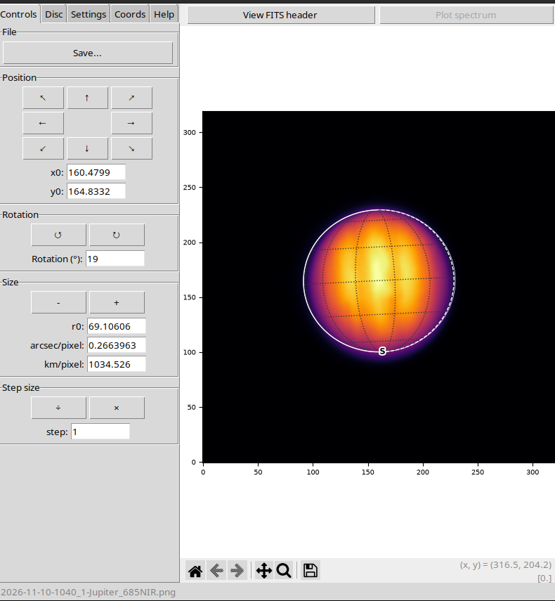

# Video Processing Repository for Jupiter Atmospheric Structure Research

## Overview

This pipeline enables automated processing of Jovian atmospheric videos for scientific data analysis. This repository contains scripts to process filtered .avi videos of Jupiter into png and sharpenened png files, and to convert these png files into fits and mapped fits files. 

## Installation

To retrieve the code with its dependencies, run : `git clone --recurse-submodules <REPO_URL>`

### Setting up dependencies

Inside of the external/wavelib directory run `cmake .` and then `make`

This pipeline requires spice kernels to be installed on computer. Follow the directions at this link: https://planetmapper.readthedocs.io/en/stable/spice_kernels.html
to install the necessary kernels. In addition to the kernels listed here, you will also need to download jup349.bsp from this link: https://naif.jpl.nasa.gov/pub/naif/generic_kernels/spk/satellites

Required python libraries are listed in requirements.txt and can be installed with `python3 -m pip install -r requirements.txt`


## Configuration

The configuration for the pipeline is specified in config/config.json. This configuration includes:

- video_input_dir: the directory with the .avi files to be processed
- png_output_dir: the directory where the generated png files will be stored. It does not need to already exist.
- fits_output_dir: the directory where the generated fits files will be stored. It does not need to already exist.
- date_string: The date prefix for the .avi files that specifies the date of the observations to be processed. This must be of the format YYYYMMDDUT
- filters: List of filters for input videos to process
- video_config: Contains configuration for video processing stage of the pipeline. May contain keys for each filter, and should contain a "default" configuration.  Each of these keys has an object value specifying the percentage of frames to stack and the sharpening preset. If any one of these keys is missing for a certain filter, the default configuration is used. Within the video configuration, you can specify the percentage of frames to stack and the wavelet sharpening configuration (currently available options are "default" or "coarse")
- run_sharpening: boolean that specifies whether to generate wavelet sharpened pngs in the video processing stage. If not included, defaults to false

Example:

```
{
    "video_input_dir": "results/video_data",
    "png_output_dir": "results/png_data",
    "fits_output_dir": "results/FITS",
    "date_string": "20261110UT",
    "filters": ["620CH4", "647NH3", "656HIA", "632OI", "685NIR", "550GRN", "450BLU", "889CH4"],
    "run_sharpening": true,
    "video_config": {
        "default": {
            "stack_percentage": 0.25,
            "sharpening": "default"
        }, 
        "889": {
            "stack_percentage": 0.5,
            "sharpening": "coarse"
        }
    }
}
```


## Usage 

### Input Requirements

The pipeline requires an input directory to be specified in `config/config.json` (video_input_dir). The input directory should contain a subdirectory titled `date_string` as specified in the config.json. This directory should contain .avi files with filenames of the form YYYY-MM-DD-HHMM_S-Jupiter_NNNFFF.avi, where NNNFFF is a placeholder for the wavelength number and filter name. An example is: `2026-11-10-1036_0-Jupiter_889CH4.avi`. This input folder should also contain files with the metadata for the observation, with the same format but a .CameraSettings.txt suffix instead of the .avi file extension (e.g. 2026-11-10-1036_0-Jupiter_889CH4.CameraSettings.txt).

### Building the video processing project

In the root directory run:

cmake -S . -B build
cmake --build build -

This will build the c++ executable as ./build/jupiter


### Running the Pipeline

The entire pipeline can be run from the pipeline.py file: `python3 -m pipeline`. This file will run the cpp executable and then the python processing to generate the png and fits files from the .avi input files.  To run just the video processing, run `./build/jupiter`. To run just the png-to-fits processing, run convert_fits.py.

When the pipeline is running a popup will appear. Navigate to the tab labeled disc and press fit disc position and fit disc radius under the fit observation section. Then navigate to the controls tab and adjust the rotation until the image is aligned. The image should look like this after adjusting:



You may then close the popup, and the settings will be applied to every file within the observation. 


### Output Structure

The intermediate output of the processing pipeline is the unsharpened and optionally unsharpened png files which will be stored in `png_output_dir/date_string` specified in the configuration. For each of the png files, a json file will be generated within this directory containing metadata about the processing confiugration used to generate the png. This file is used to generate fits headers in processL1X.

The FITS output will be stored in `fits_output_dir/date_string`. The unprocessed mapped and unmapped fits files will be stored within this directory in `unprocessed_L1` folder. The observation date folder will also contain a copy of the config.json used to run the pipeline.


## Methodology

### Video Processing

The video processing stage consists of several steps:

- selecting frames to stack
- aligning these frames to a reference frame
- stacking frame
- postprocessing
- sharpening


#### Selecting frames to stack

The processing pipeline selects the 25% sharpest frames to stack. In order to select these frames, it uses the average gradient magnitude calculated over the surface of Jupiter. Higher average gradient magnitude corresponds to an image that has larger image intensity variation.

#### Aligning frames

Once we the frames to stack are selected, the next step is to align them. The reference frame is chosen as the sharpest (highest average gradient magnitude) frame. All other frames are aligned so that their centroid sits at the same coordinates as the centroid of this reference frame.

#### Stacking Frames

The frames are then stacked by computing the average of the selected frames. The stacked output is 16-bit.

#### Post-processing

The background noise estimate is then computed as the average pixel intensity of all pixels not on the disk. This value is subtracted from the image

#### Sharpening

If sharpening is configured, sharpening is performed by doing wavelet decomposition on the output and sharpening at certain spatial scales. We use the Daubechies-4 wavelet decomposition as default. We also use a stationary wavelet transform to prevent image translation from affecting sharpening.

### FITS Processing

The image processing stage then takes the sharpened and unsharpened png files generated and converts them into unmapped and mapped fits files, with metadata stored in the headers.

## Logging

A log of the run can be found in LogFile.txt. The log specifies which files were processed, the durations of each stage, and the duration of the total pipeline. The logfile additionally specifies any warnings or processing errors that occured.

## Tools

- OpenCV
- Plog
- Planetmapper
